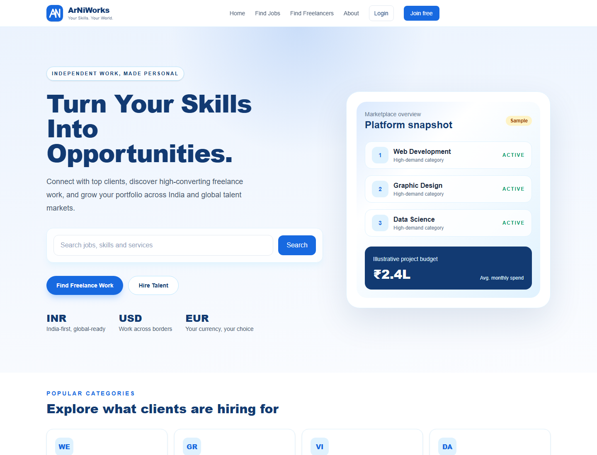
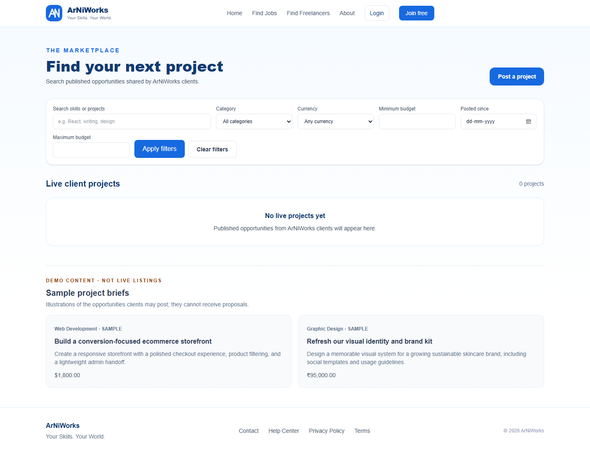
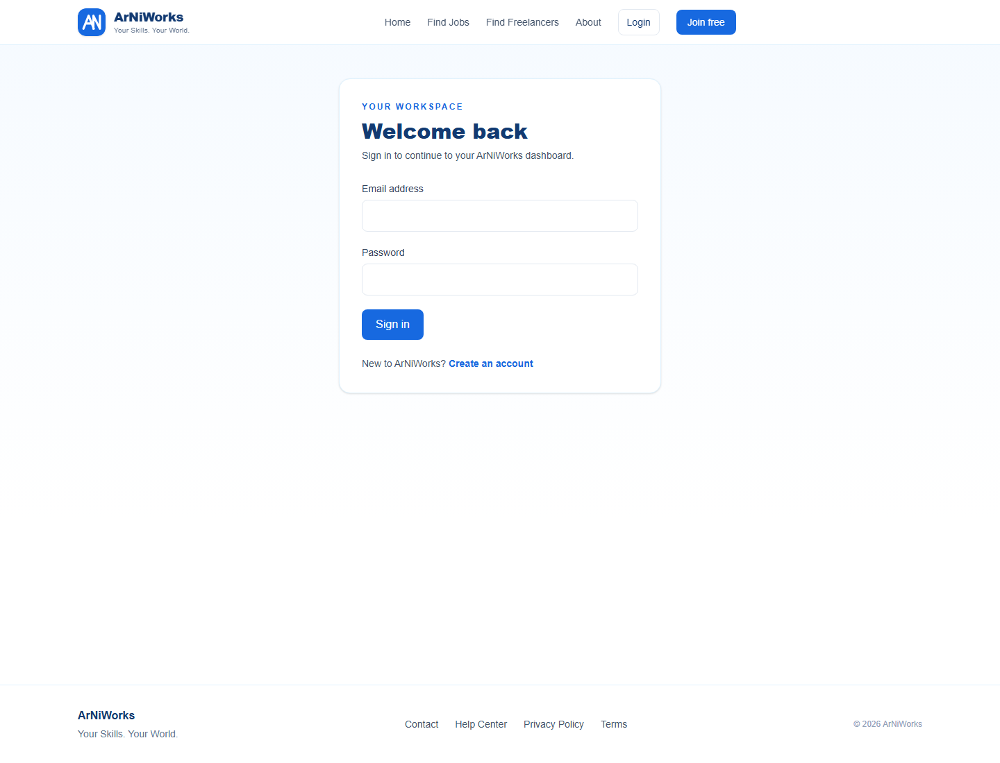

# ArNiWorks

ArNiWorks is a responsive freelance marketplace built with Next.js App Router, TypeScript, Tailwind CSS, and Supabase. Public showcase cards are explicitly labeled demo content; accounts, projects, proposals, messages, and reviews require a configured Supabase project.

## Brand and screenshots

The custom AN-inspired logo is in [`public/brand/arniworks-logo.svg`](./public/brand/arniworks-logo.svg). Screenshots below show the public demo marketplace; profile cards and sample listings are demo content.

### Homepage



### Find projects



### Sign in



## Local setup

1. Install Node.js 20.9 or later.
2. Copy `.env.example` to `.env.local` and set `NEXT_PUBLIC_SUPABASE_URL` and `NEXT_PUBLIC_SUPABASE_ANON_KEY` from your Supabase project. These must be the project URL and public anon/publishable key, never a service-role key.
3. In the Supabase SQL Editor, run [`supabase/schema.sql`](./supabase/schema.sql) once. It creates the marketplace tables, ownership policies, security functions, and the private-write/public-read profile avatar bucket.
4. In Supabase Authentication, enable email/password sign-in, set a minimum password length of 10 characters, and configure the site URL and redirect allow-list to include `http://localhost:3000/auth/callback` and your production `/auth/callback` URL. Email confirmation is supported.
5. Install and start the app:

   ```powershell
   npm.cmd install
   npm.cmd run dev
   ```

   Open `http://localhost:3000`.

Without Supabase environment variables, the public homepage and clearly labeled sample cards still render; authenticated marketplace features explain that setup is required. The app never offers demo credentials or fake sign-in.

## Administrator setup

Create and confirm a normal account first. In the Supabase SQL Editor, find its UUID in **Authentication → Users**, then promote only that trusted account:

```sql
update public.profiles
set account_type = 'admin'
where id = '<trusted-user-uuid>';
```

The admin page checks the profile server-side. Database policies independently protect account moderation, reports, project moderation, and administrator-only account listings. Regular users cannot assign themselves an administrator role or alter their account status.

## Marketplace and trust rules

- Clients own and manage their own project listings. Freelancers can create one application per open project; the database unique constraint prevents duplicates.
- Clients accept or reject proposals through a database function that checks project ownership. Accepting one proposal moves the project into progress and rejects the remaining pending proposals.
- Project participants can message only after an application is accepted.
- A project owner can mark an accepted project completed. Reviews can be submitted once per participant only after that state and the accepted-project relationship are verified in Row Level Security.
- Profile photos use the `profile-avatars` Supabase Storage bucket. Email addresses and payment-card details are not stored in marketplace profiles.
- Payments are not implemented. No payment success is simulated and no card details are collected.

## Deployment

Deploy the repository to Vercel or another Next.js App Router host. Set the two public Supabase variables in the hosting environment, add the production callback URL to Supabase Auth's redirect allow-list, and confirm the SQL schema has been applied to the production Supabase project. Run `npm.cmd run build` before deployment.

Replace the footer's `support@arniworks.com` address with a monitored support mailbox before production.
